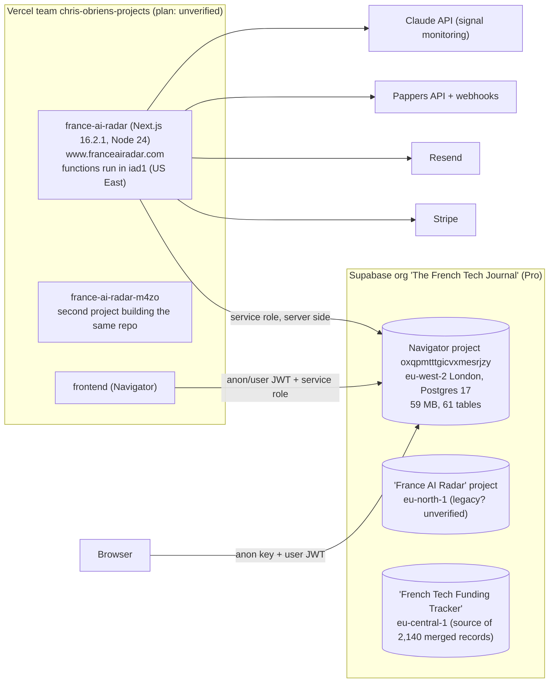

# France AI Radar Enterprise API & MCP: Stage 0 architecture audit

**Date:** 7 November 2026 · **Status:** for owner approval. No code changed, no migration run, nothing deployed.
**Handoff:** "Enterprise API & MCP Integration, Engineering Handoff v1.0" (7 Nov 2026).

Every statement below is labelled **[verified]** (checked in code, the database or a dashboard API today) or **[assumption]** (needs confirmation).

---

## Update after owner review (7 November 2026)

**Decisions received**
- **Scope: France AI Radar only.** The Navigator stays internal and is not part of the API. Any Radar company's funding history comes strictly from funding data compiled by The French Tech Journal. [owner decision; verified: the 27 funding rounds on Radar companies come from FTJ's own records (25) and the FTJ Funding Tracker (2), none from the Crunchbase-labelled imports]. The licensing question (G9, D3) therefore only applies if the Navigator becomes a public product.
- **Vercel: Pro plan** ($30/month) confirmed by the owner. Assumption 1 below is withdrawn. Functions still run in `iad1` (Washington DC) while the database is in London; moving them stays recommended (D4).
- **Do not disrupt the Navigator.** Every database change is checked against the Navigator's code and live traffic first.
- **No pilot VC firms yet** (D11). Stages 3 and 4 wait until pilots are known.
- **D1 approved and applied** (below).

**Licensing position (owner, 10 November 2026)**
- All funding data on France AI Radar companies, and all funding from 2022 onward, is data The French Tech Journal gathered and verified itself. Third-party sources may have been used to verify facts, but the dataset is FTJ's own, so nothing published through the Radar API or MCP needs a third-party licence. The API marks every round `compiled_by: "The French Tech Journal"`, lists public links only as references labelled by website, and never links to data vendors (Pitchbook, Dealroom, Crunchbase…).
- The Navigator's historical backfill did use third-party data. If the Navigator becomes a public product, decide then between licensing that history or keeping it for aggregate analysis only.
- Data fix applied the same day: three pre-2022 rounds (Navigator backfill, belonging to Green-Acres) had been attached to Castalie. They were moved back to the Green Acres record, Castalie's stale "total raised" (16.10) was cleared, and two wrong sectors (Blue Economy, WaterTech) were removed from Castalie.

**D1: what the Navigator check found** [verified in the Navigator repository and seven days of database request logs]
- The Navigator reads its data as a signed-in team member, so tightening rules for outsiders does not affect it. The Radar website reads with the server-only service role.
- Four things legitimately read **without a login**: the Navigator's public funding API (`/api/public/v1/funding/*`) and funding-hub embed, the Next 40 embed, and the quarterly deals-database pages for FTJ articles (which query the database directly from the browser). They read published funding rounds, their companies, investors and founders, sectors, cities and programme members.
- So most company and funding data is public **on purpose**: about 15,100 of 15,300 organisations are linked to a published round, an investment or a public programme. Section 1.4 overstated the leak. Also corrected: `organization_tags`, `organization_events`, `grants`, `patents`, `articles` and `products` were already team-only.

**D1: what changed** (migration `supabase/migrations/20261108_narrow_public_read.sql`, rollback in `supabase/rollbacks/`; policies only, no data or columns changed)
1. Private programme memberships (`verification_status = 'private'`, e.g. F/ai Batch 2) are hidden from everyone outside the Navigator team.
2. The Radar's technology intelligence (`organization_technical_terms`, `organization_technical_layers`, `organization_technology_claims`) is readable only by the Navigator team (and the server-side service role).
3. Funding rounds and investor rows are public only when `publish_status = 'published'`. All 13,896 rounds are published today, so nothing disappears; this stops future unpublished rounds from leaking.

**How it was tested:** before applying, the change was run inside a transaction that cancelled itself, as an anonymous visitor, a Radar subscriber and a Navigator team member. Visitors and subscribers lost the 9 private memberships and the technology tables, and kept every public count unchanged (13,896 rounds, 23,910 investor rows, 840 Next 40 members). The team kept full access. After applying: the Navigator funding API, the Next 40 embed and a Radar startup page returned normally, and every database request since has succeeded.

**Still open after D1**
- Radar draft companies' basic facts (name, website, one-line description) stay readable, like every other company, because two of them (Revox, Shiplog) appear in the public funding feed. What makes them drafts (Radar listing, profile) was already team-only.
- A Radar subscriber's login token can read the same public data as a visitor, plus internal columns such as `signal_count`. Limiting columns would break the Navigator, which reads whole rows as team members. The API will never use these tables directly (section 3), so this does not block the API.
- Supabase advisor items from section 1.4 are unchanged, except `record_profile_view`, which was already limited to the signed-in user's own id in October.

---

## 0. Summary

1. **The foundation is reusable.** The Radar already has one query path for the Database page and the CSV export (`lib/radar-dataset.ts`), a clean technical taxonomy with stable slugs, UUID primary keys, `updated_at` triggers on 29 tables and a clear publication rule (on the Radar + `status = 'active'`). A read-only REST API can be built on top without touching the website.
2. **Three blockers were identified** (status after owner review: database exposure fixed on 7 Nov; licensing reduced to Pappers/LinkedIn-derived fields by the Radar-only scope; Vercel confirmed on Pro; see the update above). As first written:
   - **Database exposure (pre-existing).** The public "anon" key shipped to every browser can read `organizations`, `people`, `funding_rounds`, `funding_round_investors`, `organization_people`, `program_organizations`, technical terms and more, including Radar drafts, ~10,000 Navigator-only companies and the editor-only F/ai Batch 2 memberships. The paywalled content (profiles, signals, legal entities) is correctly restricted. [verified]
   - **Data licensing.** About 2,400 company records and an unknown share of funding rounds were imported from files labelled `*_crunchbase`; signals cite Pappers and LinkedIn. Redistribution through a paid API needs a licence review per field. [verified sources; licence terms are an assumption]
   - **Hosting plan.** Vercel's billing API answers "Plan not found" for the team, which usually means the Hobby plan; Hobby is not licensed for commercial use. [assumption: confirm in the Vercel dashboard]
3. **The incremental sync is the real new build.** Nothing records deletions, merges or visibility changes today (`merge_organizations` deletes the merged record and keeps no alias). A change ledger fed by database triggers is required.
4. **Cost impact is small.** Even at 25 tenants the API adds well under 1% of the current database load (8.1 million statements recorded since the last reset); fixed costs (Vercel Pro, licences, a separate auth service for MCP) dominate.
5. **Re-estimate:** about 5 to 6 weeks of focused work for Stages 0.5 to 4, versus 11 to 19 days in the handoff, because of the security hardening, licensing work and MCP OAuth.

---

## 1. Current state

### 1.1 Services and repositories [verified]



- **Website repo:** `chobrien99-svg/France-AI-Radar` (this repo). **Navigator repo:** `frontend/` (separate repo, same database).
- **Crons** (`vercel.json`): trial emails 08:00, signal monitoring 01:23, signal alerts 06:41, source ingestion 02:47 UTC.
- **Region mismatch:** responses carry `x-vercel-id: iad1…` (Washington DC) while the database is in London. Every query crosses the Atlantic. [verified on a preview response]

### 1.2 Authentication and entitlements [verified]

- Supabase Auth (email/password, magic links); `proxy.ts` refreshes the session on every request and protects `/database`.
- **Entitlements are per user**, in `profiles.subscription_tier` (`explorer`, `professional`, `enterprise`) and `subscription_status`, set by the Stripe webhook (`app/api/stripe/webhook/route.ts`). `enterprise` has a price of 0 in the code and no checkout. There is **no organisation, team, seat or API-credential model**.
- Gating lives in `lib/subscription.ts` (view limits, advanced filters, CSV export) and is enforced in server code, which reads data with the **service role** (`createServiceClient()`).
- Admins: `profiles.is_admin`. Navigator staff: `is_navigator_team()` (SQL function; `@frenchtechjournal.com` users).

### 1.3 Data model relevant to the API [verified]

| Concept | Tables | Notes |
|---|---|---|
| Company | `organizations` (10,249 startups, 5,041 investors) | UUID `id`, mutable `slug`, `status` enum (`draft`, `active`, …), `updated_at` trigger |
| Radar publication | `product_organizations` → `product_catalog.slug = 'ai-radar'` | 71 on the Radar: **60 active, 11 draft**. Public pages require `status = 'active'` (`lib/radar-data.ts`, `app/page.tsx`, `lib/radar-dataset.ts`). `is_public_profile` is false everywhere and unused |
| Profile | `organization_profiles` | Investor brief, product, market, strategy, technical thesis, editor notes |
| Technology | `technical_layers` (12), `technical_terms` (135, slug + facet), `organization_technical_layers/terms` (relationship, core, evidence status, source) | Good basis for `/v1/taxonomy` |
| Sectors | `sectors`, `organization_sectors` | A second, legacy sector vocabulary (`SECTOR_LABELS` in `lib/subscription.ts`) is still in code |
| Founders | `people`, `organization_people` | `people.email` hidden from public roles (phase28) |
| Signals | `signals` (344; 277 created in the last 30 days) | Editor-approved records. **All carry `verification_status = 'unverified'`**; "approved" and "verified" are conflated. `signal_candidates` (pending/dismissed) are staff-only |
| Funding | `funding_rounds` (13,896, all `publish_status = published`), `funding_round_investors` | `amount_eur` stored in **millions**; original currency columns added this week |
| Legal | `legal_entities` (SIREN, SIRET, capital) | Restricted to the Navigator team |
| Programmes | `programs`, `program_editions`, `program_organizations` | `verification_status = 'private'` used for editor-only memberships (F/ai Batch 2) |
| Early detection | `detection_candidates`, `candidate_*`, `projects`, `awards`, `source_records`… | Staff-only (RLS on, no policies, grants revoked) |
| User data | `watchlist`, `lists`, `list_items`, `alerts`, `saved_searches`, `profile_views`, `export_usage` | Own-row RLS (`auth.uid() = user_id`) |
| History | `organization_events` (4 rows), `candidate_events`, `subscription_events`, `organization_merge_map` / `person_merge_map` (legacy import mapping) | **No general change log; merges keep no alias** (`merge_organizations()` deletes the source record) |

### 1.4 Row-level security as it stands [verified]

- **Restricted correctly:** `organization_profiles`, `signals`, `legal_entities` (Navigator team only); all detection/monitoring tables (no policies, no grants); user-owned tables (own rows only).
- **Readable by anyone with the public anon key** (policy `USING (true)` plus a table grant): `organizations` (all columns except email/phone), `people` (all except email), `funding_rounds`, `funding_round_investors`, `organization_people`, `program_organizations`, `program_editions`, `programs`, `organization_sectors`, `organization_tags`, `organization_technical_terms/layers`, `organization_technology_claims`, `organization_events`, `grants`, `patents`, `articles`, `products`.
  This exposes Radar drafts, Navigator-only companies, editor-only programme memberships and every funding row, regardless of subscription. The Navigator frontend may depend on some of these grants. [verified exposure; Navigator dependency is an assumption]
- **Supabase security advisor:** `handle_new_user`, `is_navigator_team` and `rls_auto_enable` are SECURITY DEFINER and callable by `anon`; `record_profile_view(p_user_id, …)` lets a signed-in user write view counts for any user id; leaked-password protection is off; three functions have a mutable `search_path`.

### 1.5 Reusable code [verified]

| Need | Existing code | Reuse |
|---|---|---|
| Filtered company list | `loadRadarDataset()` + `parseDatabaseQuery()` + `filterStartups()` (`lib/radar-dataset.ts`), used by `/database` and `/api/database/export` | Reuse the filter semantics; replace the "load everything then filter in JS" step with paginated SQL for the API |
| Company profile | `app/startup/[slug]/page.tsx` (inline queries), `lib/technical-profile.ts`, `lib/investors.ts` | Extract into a `getCompanyProfile()` service shared by page, API and MCP |
| Taxonomy | `lib/taxonomy.ts`, `technical_*` tables | Direct |
| Public-only field rules | `lib/share-meta.ts`, `lib/embed/cohort.ts` (no SIREN/email/phone, private memberships hidden) | Same field policy, centralised |
| Publication predicate | `radarOrgIds()` + `status = 'active'` | Make it the single definition |

---

## 2. Gap analysis

| # | Requirement (handoff §) | Today | Gap | Risk |
|---|---|---|---|---|
| G1 | Publication-safe data layer (§4) | App-level gating only; base tables readable with anon key | Close anon exposure; add a dedicated `api` schema of views/functions that only return published Radar records and allowed fields | **High**: existing leak |
| G2 | Stable external IDs, merges keep aliases (§6) | UUIDs stable; slugs change; merges delete | `entity_aliases` table + merge procedure that records aliases and emits a `merged` event | High |
| G3 | Change ledger with cursor (§6) | `updated_at` only; deletes and visibility changes untracked | Outbox `api.change_events` filled by triggers, monotonic `bigserial` cursor | High: core feature |
| G4 | Tenant model, API keys, scopes (§7, §9) | Per-user tiers only | `enterprise_tenants`, `tenant_members`, `api_credentials` (hashed), `tenant_entitlements` | Medium |
| G5 | Metering, quotas, rate limits (§7) | `export_usage` for CSV only | `api_usage_daily` + request log; per-key rate limit | Medium |
| G6 | OpenAPI contract, docs, sandbox (§5, §9) | None | Spec, docs page, sandbox tenant on a staging database branch | Medium |
| G7 | Approved vs verified semantics (§1) | All signals "unverified" though approved | Expose `publication_status` (approved) separately from `verification_status` (evidence) | Medium: misleading output |
| G8 | Projects vs companies (§1) | Pre-company projects live only in staff-only detection tables | Keep projects out of P0/P1 until an editor publication step exists | Low (deferred) |
| G9 | Licensing per field (§3) | Mixed sources incl. `*_crunchbase`, Pappers, LinkedIn | Field-level licence matrix; exclude unlicensed fields from the API | **High**: legal |
| G10 | Remote MCP with client auth (§8) | None | MCP endpoint (Streamable HTTP) + OAuth 2.1 authorisation server | Medium |
| G11 | Monitoring per tenant (§12) | Vercel/Supabase defaults | Structured request log, p50/p95, slow-query report | Low |
| G12 | Hosting fit for commercial API | Plan unverified; functions in iad1; duplicate project | Verify/upgrade plan; move functions to `lhr1` (London) or `cdg1`; clarify `france-ai-radar-m4zo` | Medium |

---

## 3. Proposed architecture

```
VC CRM / script ──HTTPS──▶ api.franceairadar.com/v1/*  (Next.js route handlers, same repo)
AI client ───────MCP────▶ api.franceairadar.com/mcp     (MCP over Streamable HTTP)
                                 │
                     auth: API key (REST) / OAuth token (MCP)
                                 │
                     lib/api/ domain services  ◀── also used by /database, CSV export, startup page
                                 │  (service role, never exposed)
                     Postgres schema `api` (views + SECURITY INVOKER functions over published records)
                                 │
                     Navigator canonical tables (unchanged ownership)
```

- **Same Next.js app, new `/v1` routes** [recommendation]: reuses auth helpers, query code and deployment; a separate service can come later if load requires it.
- **The `api` schema is the trust boundary**: views return only Radar-published (`status = 'active'`) companies, their founders, editor-approved signals and allowed fields. API code queries only this schema. Postgres RLS on base tables stays as defence in depth.
- **MCP tools call the same services as REST**, never raw SQL.
- **No customer ever receives a Supabase key.**

---

## 4. REST contract (draft OpenAPI 3.1, abridged)

```yaml
openapi: 3.1.0
info: { title: France AI Radar Enterprise API, version: "1.0.0" }
servers: [{ url: https://api.franceairadar.com/v1 }]
components:
  securitySchemes:
    apiKey: { type: http, scheme: bearer, description: "far_live_… key, scoped per tenant" }
  schemas:
    Company:
      type: object
      required: [id, slug, name, url, record_version, updated_at, publication_status]
      properties:
        id: { type: string, format: uuid, description: "Stable. Never reused." }
        slug: { type: string }
        aliases: { type: array, items: { type: string, format: uuid }, description: "IDs merged into this one" }
        name: { type: string }
        url: { type: string, format: uri, description: "Canonical franceairadar.com profile" }
        short_description: { type: [string, "null"] }
        website: { type: [string, "null"], format: uri }
        linkedin_url: { type: [string, "null"], format: uri }
        country: { type: string }
        city: { type: [string, "null"] }
        founded_year: { type: [integer, "null"] }
        sectors: { type: array, items: { $ref: "#/components/schemas/TermRef" } }
        technology: { $ref: "#/components/schemas/Technology" }
        founders: { type: array, items: { $ref: "#/components/schemas/PersonRef" } }
        funding: { type: array, items: { $ref: "#/components/schemas/Round" } }
        latest_signal_at: { type: [string, "null"], format: date-time }
        publication_status: { enum: [published, withdrawn] }
        record_version: { type: integer, description: "Increments on every publishable change" }
        updated_at: { type: string, format: date-time, description: "UTC" }
    Signal:
      type: object
      properties:
        id: { type: string, format: uuid }
        company_id: { type: string, format: uuid }
        type: { enum: [fundraising, hiring_surge, key_hire, new_product, partnership, award, …] }
        date: { type: string, format: date }
        title: { type: string }
        description: { type: [string, "null"] }
        strength: { type: integer, minimum: 1, maximum: 5 }
        source: { type: object, properties: { name: { type: string }, url: { type: [string, "null"] } } }
        publication_status: { const: approved }
        verification_status: { enum: [verified, reported, unverified] }
        record_version: { type: integer }
    ChangeEvent:
      type: object
      required: [event_id, cursor, entity_type, entity_id, event_type, record_version, occurred_at]
      properties:
        event_id: { type: string, format: uuid }
        cursor: { type: string, description: "Opaque; resume after this event" }
        entity_type: { enum: [company, signal, person] }
        entity_id: { type: string, format: uuid }
        event_type: { enum: [created, updated, corrected, merged, withdrawn, deleted] }
        record_version: { type: integer }
        occurred_at: { type: string, format: date-time }
        changed_fields: { type: array, items: { type: string } }
        merged_into: { type: [string, "null"], format: uuid }
        href: { type: [string, "null"], description: "Canonical fetch path; null for withdrawn/deleted" }
    Error:
      type: object
      properties: { error: { type: object, properties: { code: { type: string }, message: { type: string }, request_id: { type: string } } } }
paths:
  /companies:
    get:
      summary: Published Radar companies
      parameters:
        - { name: q, in: query, schema: { type: string } }
        - { name: sector, in: query, schema: { type: array, items: { type: string } }, style: form, explode: false }
        - { name: layer, in: query, schema: { type: array, items: { type: string } }, style: form, explode: false }
        - { name: term, in: query, schema: { type: array, items: { type: string } }, style: form, explode: false }
        - { name: stage, in: query, schema: { type: array, items: { type: string } }, style: form, explode: false }
        - { name: city, in: query, schema: { type: string } }
        - { name: updated_since, in: query, schema: { type: string, format: date-time } }
        - { name: sort, in: query, schema: { enum: [updated_at, name, latest_signal_at], default: updated_at } }
        - { name: limit, in: query, schema: { type: integer, maximum: 100, default: 50 } }
        - { name: cursor, in: query, schema: { type: string } }
      responses: { "200": { description: "{ data: Company[], next_cursor }" }, "401": {}, "403": {}, "429": {} }
  /companies/{id}: { get: { summary: "Company by id, alias or slug; 301-style `merged_into` for merged ids, 410 for withdrawn" } }
  /signals: { get: { summary: "Approved signals; filters company_id, type, since, until; same pagination" } }
  /taxonomy: { get: { summary: "Sectors, technical layers, terms (slug, label, facet, parent), signal types, stages" } }
  /changes:
    get:
      summary: Change feed
      parameters:
        - { name: cursor, in: query, schema: { type: string }, description: "Omit to start from the snapshot cursor" }
        - { name: limit, in: query, schema: { type: integer, maximum: 500, default: 200 } }
      responses: { "200": { description: "{ data: ChangeEvent[], next_cursor, has_more }" }, "410": { description: "cursor_expired: resync" } }
  /snapshot: { post: { summary: "Start an initial sync: returns snapshot_id and the cursor to replay from afterwards" } }
```

Conventions: UTC ISO 8601 timestamps; opaque base64 cursors (keyset on `(updated_at, id)` for lists, on `seq` for changes); page size caps (100 lists, 500 changes); error codes `invalid_parameter`, `unauthorized`, `forbidden_scope`, `not_found`, `gone`, `rate_limited`, `cursor_expired`, `internal`; `Retry-After` on 429; every response carries `X-Request-Id`.

**Field policy for P0** [needs approval, see D3]: name, slug, URLs, descriptions, location, founded year, sectors, technology, founder names/roles/public links, approved signals with source name and URL, programme memberships that are not private, funding rounds **only from sources cleared for redistribution**. Never: SIREN/SIRET, capital, emails, phones, editor notes (`analyst_note`, `technical_thesis`, `entity_complexity`), detection candidates, private memberships, other tenants' lists.

**Deferred:** `/v1/people` (P1, once founder coverage is reviewed), `/v1/projects` (P1, needs an editor publication step for detection projects), `POST /v1/first-call-requests` (P2).

---

## 5. Incremental sync design

### 5.1 Change ledger
- `api.change_events(seq bigserial primary key, event_id uuid, entity_type, entity_id, event_type, record_version, occurred_at timestamptz, changed_fields text[], merged_into uuid, visibility text)`.
- Filled **in the same transaction** as the data change, by triggers on `organizations`, `product_organizations`, `organization_profiles` (only public columns), `organization_sectors`, `organization_technical_*`, `organization_people`, `people`, `signals`, `funding_rounds`, `funding_round_investors`. Triggers write only when a **publishable** field of a **published** record changes, so editor-only edits never appear in the feed.
- Visibility changes: draft → active emits `created`; active → draft/inactive or removal from the Radar emits `withdrawn` (no fields, no names). Deletion emits `deleted`. Merge emits `merged` with `merged_into` and writes `entity_aliases(old_id, new_id)`.
- `record_version` per entity in `api.entity_versions(entity_type, entity_id, version)`.

### 5.2 Gap-free initial sync
1. `POST /v1/snapshot` records `snapshot_seq = max(seq)` and returns it as the replay cursor.
2. Client pages `/v1/companies?snapshot=…` (keyset pagination; records changing meanwhile may appear in their newer state).
3. Client replays `/v1/changes?cursor=<snapshot_seq>`. Because events are idempotent (`event_id`) and carry `record_version`, any record seen twice is reconciled by keeping the highest version. Result: no gaps, at most duplicates, which the client discards.

### 5.3 Delivery rules
- At-least-once; the client advances its stored cursor only after processing a page.
- **Sequence gaps:** `bigserial` can commit out of order under concurrent writes. The feed only serves events with `seq <=` the lowest in-flight sequence (tracked with a short `pg_snapshot_xmin`-based safe point), so a slow transaction can never be skipped.
- Retention: 90 days [proposal]; an older cursor returns `410 cursor_expired` and the client resyncs.
- Tenants see only entity types their entitlement allows; withdrawn events contain no data beyond ids.

### 5.4 Example integration client (Python, illustrative)

```python
import os, time, json, requests
API = "https://api.franceairadar.com/v1"
H = {"Authorization": f"Bearer {os.environ['FAR_API_KEY']}"}
state = json.load(open("far_state.json")) if os.path.exists("far_state.json") else {}

def get(path, **params):
    while True:
        r = requests.get(f"{API}{path}", headers=H, params=params, timeout=30)
        if r.status_code == 429:
            time.sleep(int(r.headers.get("Retry-After", "5"))); continue
        r.raise_for_status(); return r.json()

if "cursor" not in state:                               # initial sync
    snap = requests.post(f"{API}/snapshot", headers=H, timeout=30).json()
    page = {"next_cursor": None}
    while True:
        page = get("/companies", limit=100, snapshot=snap["snapshot_id"], cursor=page["next_cursor"])
        for c in page["data"]: crm_upsert(c)            # your CRM write, keyed on c["id"]
        if not page["next_cursor"]: break
    state["cursor"] = snap["replay_cursor"]

while True:                                              # incremental sync
    page = get("/changes", cursor=state["cursor"], limit=500)
    for e in page["data"]:
        if e["event_type"] in ("withdrawn", "deleted"): crm_archive(e["entity_id"])
        elif e["event_type"] == "merged": crm_merge(e["entity_id"], e["merged_into"])
        else: crm_upsert(get(f"/{e['entity_type']}s/{e['entity_id']}"))
    state["cursor"] = page["next_cursor"]; json.dump(state, open("far_state.json", "w"))
    if not page["has_more"]: break
```

A test harness will replay a scripted sequence (create, edit, correct, merge, withdraw, republish, delete) against a staging database and assert the CRM mirror matches the published state exactly, with retries and injected 429s/timeouts.

---

## 6. MCP design (Stage 4)

**Transport:** MCP Streamable HTTP at `/mcp`, stateless, read-only.
**Tools** (each wraps a domain service; outputs keep source URLs, dates and verification labels; descriptions tell the model to cite `url` and not infer missing facts):

| Tool | Input schema (JSON Schema, abridged) | Output |
|---|---|---|
| `search_companies` | `{ query?: string, sectors?: string[], technical_terms?: string[], stage?: string[], city?: string, updated_since?: date-time, limit?: 1–25, cursor?: string }` | Company summaries + `next_cursor` |
| `get_company_profile` | `{ id_or_slug: string }` | Full public profile, founders, signals, funding with sources |
| `search_signals` | `{ company_id?: uuid, types?: string[], since?: date, until?: date, limit?: 1–50, cursor?: string }` | Signals |
| `get_recent_changes` | `{ since?: date-time, limit?: 1–100 }` | Human-readable change summaries (not the sync cursor) |
| `get_taxonomy` | `{}` | Sectors, layers, terms, signal types |
| later: `search_people`, `search_projects` | | |

Errors returned as MCP tool errors with the same codes as REST. No arbitrary SQL, browsing or writes.

**Authentication** [assumption: verify against current client versions in Stage 4]: MCP authorisation is OAuth 2.1 (protected-resource metadata, PKCE). Hosted clients such as Claude.ai custom connectors and ChatGPT connectors expect OAuth; developer clients (Claude Code, Cursor, VS Code) can usually send a static `Authorization` header, so a scoped API key may suffice for a first pilot. Options: Supabase Auth's OAuth server capability (if generally available on our plan), or a managed provider (WorkOS, Stytch, Auth0). Decision D8.

---

## 7. Schema and migration plan (additive, reversible)

| Migration | Contents | Rollback |
|---|---|---|
| **M0 Hardening** (Stage 0.5) | Revoke anon/authenticated SELECT on base tables the Radar site does not read with the anon key; limit `program_organizations` to non-private rows; revoke anon EXECUTE on SECURITY DEFINER helpers; pin `search_path`; make `record_profile_view` use `auth.uid()` | Re-grant script (generated from current grants before applying); verify Navigator first |
| **M1 API schema** | `create schema api`; views `api.companies`, `api.company_founders`, `api.signals`, `api.funding_rounds_public`, `api.taxonomy_*`; SECURITY INVOKER; no grants to anon/authenticated | `drop schema api cascade` |
| **M2 Identity** | `entity_aliases(old_id, new_id, entity_type, merged_at)`; new `merge_organizations_v2()` that records aliases | Drop table; old function unchanged |
| **M3 Change ledger** | `api.change_events`, `api.entity_versions`, trigger functions, backfill of `created` events for current published records | Drop triggers, then tables |
| **M4 Tenancy** | `enterprise_tenants`, `tenant_members`, `api_credentials(prefix, sha256_hash, scopes[], expires_at, revoked_at, last_used_at)`, `tenant_entitlements`, `api_usage_daily`, `api_request_log` (30-day retention) | Drop tables |
| **M5 First Call** (later) | `first_call_requests`, `first_call_reports` (private storage bucket) | Drop |

Every migration follows the Phase 1 process: run on a staging branch, dry-run on production inside a self-cancelling transaction, then apply with your go-ahead, with a rollback file in `supabase/rollbacks/` and SQL tests in `supabase/tests/`.

---

## 8. Threat model and security tests

| Threat | Control | Automated test |
|---|---|---|
| Customer reads unpublished or internal data | `api` schema views; API code cannot query base tables | Draft company, detection candidate, private membership, editor note: each returns 404 / absent field |
| Customer uses the public anon key directly | M0 hardening | anon key `select` on each base table returns 0 rows / permission denied |
| Cross-tenant access | Tenant derived from the key server-side; never from request input | Tenant A key cannot read tenant B usage, lists or First Call requests |
| Key theft | SHA-256 hashed keys, prefix shown once, expiry, revocation, last-used audit; raw keys never logged | Revoked/expired key → 401 within one request |
| Leak via change feed | Triggers only emit for published records; withdrawn events carry ids only | Withdraw → event has no name/fields; draft edits produce no event |
| Scraping / abuse | Per-key rate limit (e.g. 60 req/min), page caps, daily record quotas, query timeouts (5 s) | 429 with `Retry-After`; oversize `limit` rejected |
| MCP prompt injection | Read-only tools; output is data, not instructions; no tools that act | Tool list contains no write operations |
| Personal data (GDPR) | Founders' public professional data only; legitimate-interest assessment; removal requests propagate as `withdrawn` | Removed person disappears from API and feed |

Documents needed before external access: privacy notice update for API recipients, data processing terms, source/licence register, incident response contact.

---

## 9. Usage baseline and cost scenarios

**Baseline** [verified unless marked]: database 59 MB; 61 tables; largest table `organizations` 12 MB; `max_connections` 60 (suggests the smallest compute size); 8.1 million statements since stats reset, dominated by Navigator's PostgREST reads of `funding_rounds` and `organizations` (≈250–460 ms each). Radar: 71 Radar companies, 54 updated and 277 signals created in the last 30 days. Supabase org plan: **Pro**. Vercel plan: **unverified**; per-day billing data unavailable through the API.

**Assumptions for scenarios:** published dataset ≈ 100 companies growing to 500 within a year; each tenant runs one change-feed sync per hour (24 calls/day, mostly empty), one weekly full resync (≈5 pages), 200 search/profile calls/day from internal tools, and 300 MCP tool calls/day.

| | 5 tenants | 10 tenants | 25 tenants |
|---|---|---|---|
| API requests / month | ≈ 80,000 | ≈ 160,000 | ≈ 400,000 |
| Database time / month (≈ 20 ms avg per indexed query) | ≈ 0.5 h | ≈ 1 h | ≈ 2.5 h |
| Response transfer / month (≈ 20 KB avg) | ≈ 1.6 GB | ≈ 3.2 GB | ≈ 8 GB |
| Function compute | negligible vs current site | negligible | low |

**Conclusion:** incremental infrastructure cost is minor at these volumes. The real costs are fixed: Vercel Pro if the team is on Hobby (per-seat pricing; verify current price), an OAuth provider for MCP if Supabase's cannot be used (free tiers likely cover a pilot), possibly a larger Supabase compute size if Navigator's own load grows, and **data licences** (Pappers commercial terms, any funding-data source cleared for redistribution). AI enrichment (Claude API for signal monitoring) is an existing cost, unaffected by the API.

**Controls:** indexes on `api` view filter columns and `change_events(seq)`; tenant-safe caching (cache keys include tenant id and entitlement hash; only public taxonomy is cached globally); spend alerts on both Vercel and Supabase; per-tenant quotas.

---

## 10. Implementation sequence and estimates (re-estimated)

| Stage | Tickets | Estimate |
|---|---|---|
| **0.5 Security & hosting** (new) | T1 Grant inventory + Navigator dependency check · T2 M0 hardening migration + tests · T3 Verify Vercel plan; move functions to London; resolve `france-ai-radar-m4zo` · T4 Licence register per field | 3–4 days + your decisions |
| **1 REST foundation** | T5 `api` schema views (M1) · T6 `lib/api` services extracted from page/dataset code · T7 `/v1/companies`, `/{id}`, `/signals`, `/taxonomy` with validation · T8 OpenAPI file + generated docs page · T9 Contract tests | 5–6 days |
| **2 Change feed** | T10 Aliases + merge v2 (M2) · T11 Ledger, triggers, backfill (M3) · T12 `/v1/snapshot`, `/v1/changes`, safe-point logic · T13 Sync simulation harness | 5–6 days |
| **3 Enterprise pilot** | T14 Tenancy + keys + usage (M4) · T15 Admin screen to create tenants/keys · T16 Rate limits, quotas, request log, monitoring view · T17 Docs, sample client, sandbox tenant on a staging branch | 5 days |
| **4 Remote MCP** | T18 MCP endpoint wrapping services · T19 OAuth integration · T20 Tests in 2 pilot clients | 4–6 days |
| **5 First Call** | Separate approval | later |

Total ≈ **22–27 working days** for Stages 0.5–4.

---

## 11. Decisions needed from you

| # | Decision | Recommendation |
|---|---|---|
| D1 | Approve Stage 0.5 hardening of public database access (after checking what the Navigator relies on) | **Approved and applied 7 Nov** (see the update at the top) |
| D2 | Dataset scope: Radar-published companies only, or also Navigator-wide companies and funding | **Decided: Radar only** |
| D3 | Field policy, especially Pappers-derived facts, LinkedIn-sourced signals and logos | **Funding settled 10 Nov:** all Radar funding is FTJ-compiled; no licence needed. Still to confirm: Pappers-derived facts and LinkedIn-sourced signal text |
| D4 | Vercel plan; move functions to London (`lhr1`) | **Plan confirmed: Pro.** Moving functions to London still recommended |
| D5 | What is `france-ai-radar-m4zo`? Keep or remove | Confirm, then remove if unused |
| D6 | Are the "France AI Radar" (Stockholm) and "French Tech Funding Tracker" Supabase projects still used? | Leave untouched; no API reads from them |
| D7 | Hosting: same app at `api.franceairadar.com` | Yes |
| D8 | MCP auth: API key for developer clients first, OAuth provider choice for hosted clients | Pilot with keys; choose OAuth provider once pilot clients are known |
| D9 | "Approved" vs "verified" wording for signals, and whether to backfill `verification_status` | Expose both; backfill later |
| D10 | Change-feed retention (90 days proposed) and resync policy | 90 days |
| D11 | Pilot firms, their CRMs (Affinity, HubSpot, Attio, Salesforce…) and AI clients | **None yet.** Needed before Stage 3 |
| D12 | Pricing and billing: none activated until you approve | — |

---

## 12. Assumptions to confirm

1. ~~Vercel team is on Hobby.~~ Withdrawn: the owner confirmed the Pro plan.
2. Function region is `iad1` for all routes (observed on preview and production responses).
3. ~~The Navigator may rely on public grants.~~ Checked: see the update at the top.
4. Pappers-derived facts and LinkedIn-sourced signal text may need permission before redistribution through a paid API (Crunchbase no longer applies: Radar funding is FTJ's own).
5. The two other Supabase projects are not read by the Radar site.
6. MCP client authentication requirements as described in §6 (to re-verify against current client releases).
7. Scenario usage numbers in §9 are estimates, not measurements.
